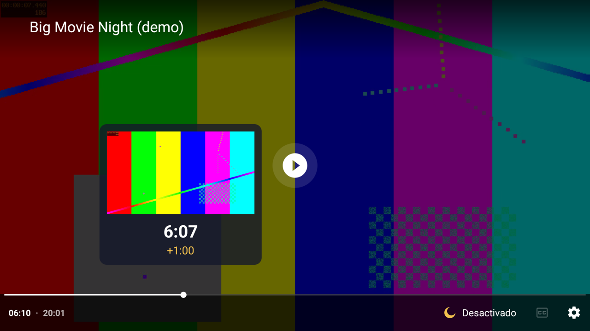

# NightPlayer

**An external video player for Stremio on Android TV with a "night mode": quieter explosions, clearer dialogue, no more riding the volume button.**

Movie soundtracks are mixed for cinemas. On TV speakers that means whispering dialogue followed by explosions that wake up the whole house. NightPlayer plugs into Stremio as an external player and levels the audio in software, so it works on TVs that don't have a "volume leveler" or "night mode" setting.



## Features

- **Night mode audio** with three profiles you can switch while watching, from the remote:
  - **Off**: plain stereo downmix, no processing.
  - **Soft**: gentle leveling, +3 dB dialogue.
  - **Night**: strong leveling, +6 dB dialogue. In tests, an "explosion" ends up ~5 dB above the dialogue instead of ~30 dB.
- **Dialogue boost for 5.1/7.1:** downmixes surround to stereo while raising the center channel, which is where the voices live.
- **Plays the formats your TV can't:** AC3, E-AC3 (Dolby Digital Plus), DTS and more are decoded in software with FFmpeg, so the audio can be processed (and actually plays on TVs without those decoders).
- **Resume with Stremio:** starts where Stremio tells it to, and hands the position back when you exit, so Stremio remembers where you left off.
- **TV-friendly seeking:** ←/→ jump 10 s; hold to speed up. A preview box shows a thumbnail of the target frame, the time and how far you're jumping.
- **Audio track and embedded subtitle selection.** Remembers the last language you picked and prefers audio in your TV's language.
- Remembers your last profile. Remote-only controls, no touch needed.

## Install

1. Download `NightPlayer-x.y.z.apk` from [Releases](../../releases).
2. Sideload it on your Android TV / Google TV:
   - **With ADB:** enable Developer options and USB/network debugging on the TV, then run `adb connect <tv-ip>` and `adb install NightPlayer-x.y.z.apk`.
   - **Without a PC:** use an app like *Downloader* or *Send Files to TV* and allow installing from unknown sources.
3. In Stremio: **Settings → Playback → Default player → External**.
4. Play something and pick **NightPlayer** in the Android chooser. Choose **Always** if you don't want to be asked again.

Requires Android 8.0+ (tested on a Xiaomi TV running Android 10).

## Remote controls

| Key | Action |
| --- | --- |
| **← / →** | Seek 10 s per press; hold to accelerate (10 s → 30 s → 60 s → 2 min). The current scene freezes in the background while a thumbnail of the target frame, the time and the jump size show above the timeline. Release (~1 s) or press OK to jump. |
| **OK** | Confirm the seek, or play / pause |
| **Menu** | Cycle audio profile (Off → Soft → Night) |
| **↑ / ↓** | Show controls; ↓ moves to the button row (profile, subtitles, settings), where ←/→/OK move focus and press |
| **Back** | Cancel a seek in progress; otherwise return to Stremio |

The audio track is in the ⚙️ settings button. Embedded subtitles are under **CC**.

## Good to know

- **Stremio's addon subtitles don't reach external players.** Stremio only passes the stream URL and the resume position. NightPlayer shows the subtitles embedded in the file.
- **No passthrough to soundbars/AVRs.** Processing the audio means decoding it to stereo PCM. If you use a surround system, you probably don't need this app.
- **Seek thumbnails are the nearest keyframe**, so they can be a few seconds off. How fast they appear depends on how quickly your stream source responds (about 0.2–0.9 s per frame with Real-Debrid in my tests).
- Video decoding is still done by your TV. If your TV can't play a video codec (some HEVC / Dolby Vision files), NightPlayer can't either.

## How it works

ExoPlayer (AndroidX Media3) with a custom audio chain running on PCM before it reaches the speakers:

1. **Dialog downmix:** `L = FL + c·FC + 0.5·SL`, `R = FR + c·FC + 0.5·SR`, where the center gain `c` depends on the profile. LFE is dropped.
2. **Compressor:** feed-forward, stereo-linked, ~10 ms RMS detector, 6 dB soft knee, attack/release and makeup gain.
3. **Limiter:** 5 ms lookahead, −1 dBFS ceiling, 80 ms release.

Profile changes are smoothed over ~50 ms, so switching never clicks or interrupts playback. The DSP has JVM unit tests with synthetic signals.

## Build from source

- JDK 17+, Android SDK (platform 37). Gradle is included (`gradlew`).
- The release signing config is read from `local.properties` or environment variables. It is never stored in the repo:

  | `local.properties` | Environment variable |
  | --- | --- |
  | `nightplayer.storeFile` | `NIGHTPLAYER_STORE_FILE` |
  | `nightplayer.storePassword` | `NIGHTPLAYER_STORE_PASSWORD` |
  | `nightplayer.keyAlias` | `NIGHTPLAYER_KEY_ALIAS` |
  | `nightplayer.keyPassword` | `NIGHTPLAYER_KEY_PASSWORD` |

```bash
./gradlew :app:testDebugUnitTest
```

```bash
./gradlew assembleRelease
```

The APK ends up in `app/build/outputs/apk/release/`. Without a keystore configured, the release APK is unsigned. Use `./gradlew assembleDebug` for a quick signed debug build.

Code comments are in Spanish.

## Credits & license

- Vibe-coded with [Claude](https://claude.ai) (Claude Code): I described the problem and reviewed and tested on my TV; Claude wrote the code, the DSP and the tests.
- [AndroidX Media3 / ExoPlayer](https://github.com/androidx/media) (Apache 2.0).
- [Jellyfin's FFmpeg decoder for Media3](https://github.com/jellyfin/jellyfin-androidx-media) (GPL-3.0).

Because it bundles the GPL-3.0 FFmpeg decoder, NightPlayer is licensed under the **GNU GPL v3.0**. See [LICENSE](LICENSE).

Not affiliated with Stremio.
